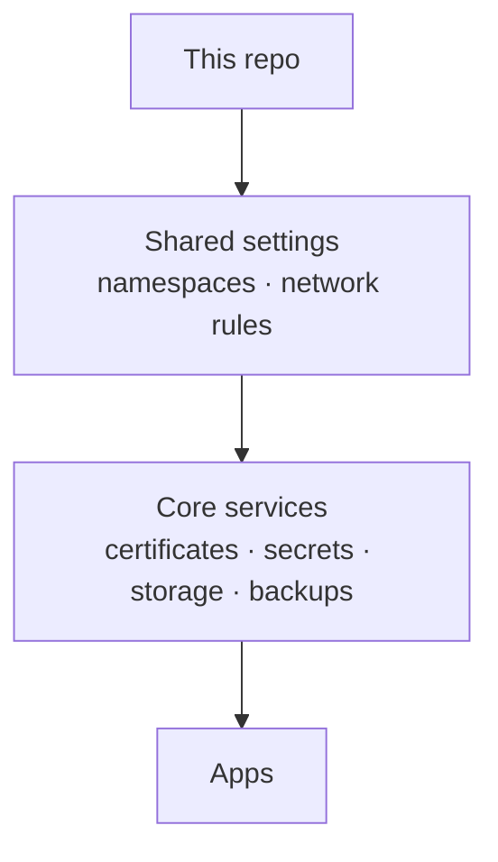
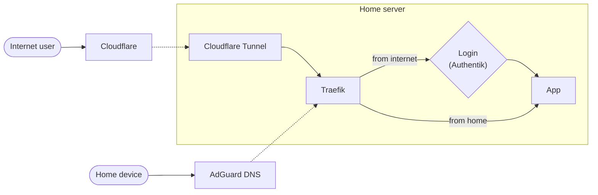

<div align="center">

# 🏠 K-Homelab

_My home Kubernetes cluster, fully self-hosted and run straight from this repo._

[](https://k3s.io)
[](https://fluxcd.io)
[](https://www.mend.io/renovate)

[](https://github.com/gabroz42/k-homelab/actions/workflows/ci.yaml)
[](https://github.com/gabroz42/k-homelab/commits/main)

</div>

---

Welcome to my homelab repo,
here is a full presentation of my own Kubernetes cluster.

Everything running on the server is described in this repo. I edit a file, push it, and the cluster updates itself to match, so nothing is configured by hand.

## The hardware

Almost all hardware used was recycled from previous upgrades, found lying around or gifted by friends. The only things I had to buy were the micro-ATX parts (mobo, case and PSU, the cheapest I could find).

| Part              | What                       |
| ----------------- | -------------------------- |
| **CPU**           | AMD Ryzen 2600X            |
| **RAM**           | 32GB DDR4                  |
| **Main drive**    | 1TB Sabrent NVMe           |
| **Storage NVMe**  | 500GB Samsung NVMe (photos)|
| **Films drive**   | 4TB HDD                    |
| **Backup drive**  | 2TB HDD                    |
| **UPS**           | 600W                       |

The system and the cloud storage services that need to be fast run on the NVMe drives. The UPS is monitored too, so I get an alert on a power cut or when the battery is getting tired, and the fans are controlled by Pankha based on the motherboard sensors.

## The software

This is how my home Kubernetes cluster is configured:

| Software                                                       | Used for                                               |
| -------------------------------------------------------------- | ------------------------------------------------------ |
| [k3s](https://k3s.io)                                          | Lightweight Kubernetes distribution                    |
| [Flux](https://fluxcd.io)                                      | Keeps the cluster in sync with this repo               |
| [Renovate](https://www.mend.io/renovate)                       | Opens merge requests when a new app or chart version comes out |
| [Traefik](https://traefik.io)                                  | Ingress controller                                     |
| [MetalLB](https://metallb.io)                                  | Load balancer                                          |
| [Cloudflare Tunnels](https://github.com/cloudflare/cloudflared) | Remote access to the public services                  |
| [AdGuard Home](https://adguard.com/adguard-home/overview.html) | DNS and ad blocking                                    |
| [Authentik](https://goauthentik.io)                            | Single login for every app                             |
| [cert-manager](https://cert-manager.io)                        | HTTPS certificates                                     |
| [Longhorn](https://longhorn.io)                                | App storage                                            |
| [Prometheus](https://prometheus.io), [Loki](https://grafana.com/oss/loki/), [Grafana](https://grafana.com) | Metrics, logs and alerts |

When I push to `main`, a webhook tells Flux right away and the change gets applied in three steps: first the shared settings, then the core services, then the apps. Values that change between setups (domain, timezone, IPs, disk paths) are written once in a single settings file instead of being repeated everywhere.



### Repo layout

```
clusters/homelab     # where Flux starts, plus the shared settings
infrastructure       # core services the apps depend on
apps                 # one folder per app
bootstrap            # script to rebuild the cluster on a new machine
docs                 # detailed handbook and runbooks
scripts              # helper scripts
schema               # architecture diagrams
```

<details>
<summary>Cluster diagram</summary>

<br>

<picture>
  <source media="(prefers-color-scheme: dark)" srcset="schema/cluster-schema-dark.png">
  <source media="(prefers-color-scheme: light)" srcset="schema/cluster-schema-light.png">
  
</picture>

</details>

## Networking

First, a pool of IP addresses is reserved for MetalLB and Traefik is given an IP.
Then, a DNS rewrite is configured in AdGuard Home so browsers in my network can reach every local service at `*.local.gabro.ovh` by asking Traefik for it via hostname. For publicly exposed services Traefik is set as the target of the Cloudflare tunnels.

All services exposed to the outside world do so via a Cloudflare tunnel pod, so no ports are open on my router. Each tunnel runs two pods, so if one goes down the service stays up. Public services also go through Authentik, so you have to log in before reaching any app.



### Public services

Here are the services that are exposed to the internet:

- **Jellyfin** for streaming films and TV
- **Dispatcharr** for live TV
- **Nextcloud** as a general purpose cloud storage for files
- **Immich** as a personal Google Photos substitute
- **Navidrome** for music streaming
- **Matrix** for chat
- **Grafana** for monitoring
- **GitLab** for hosting this repo and running the CI
- **Authentik** as a centralized authentication provider
- **Centralino**, a home automation panel for the ESP32 boards

### Private services

- **Arr stack** for feeding Jellyfin and Navidrome
- **AdGuard Home** as a network filter and for DNS rewrites in the local network
- **Headlamp** as a Kubernetes dashboard
- **Pankha** for fan and temperature control
- **Homepage** as a start page with every service

The server itself is only reachable over VPN.

## Storage and backups

- **Longhorn** manages the NVMe drives for the apps
- **MinIO** is used as S3 storage behind Nextcloud
- **Backup jobs** copy app data and databases with restic to the backup drive every week

The backup server only accepts new backups and never lets anyone delete or overwrite the old ones, so even a hacked app can't wipe them. I keep 7 daily, 4 weekly and 12 monthly copies and get an alert if a backup fails.

## Secrets

No passwords or tokens are in this repo. They are stored in Bitwarden Secrets Manager and pulled into the cluster when needed, and when one changes the apps using it restart by themselves. Rotating a password is a single command:

```sh
task autorotate-postgres app=nextcloud   # new database password, everywhere
task rotate-tunnel svc=jellyfin          # new Cloudflare tunnel token
```

## Rebuilding from scratch

If the server dies, a single script sets the whole cluster up again on a fresh Ubuntu machine:

```sh
cp bootstrap/site.env.example bootstrap/site.env   # fill in your domain, IPs and tokens
task render-settings                               # turn it into the settings file, then push
task bootstrap                                     # run on the new machine
```

This brings back the apps and the config, the data comes back separately from the backups. The full walkthrough is in [`docs/INSTRUCTIONS.md`](docs/INSTRUCTIONS.md).

## Day to day

```sh
task status      # what's running
task bad         # anything broken
task reconcile   # sync with Git right now
```

Every change is checked automatically before it's merged, using [kubeconform](https://github.com/yannh/kubeconform) and [flate](https://github.com/home-operations/flate).

Lastly:

### Why Kubernetes instead of simple Docker for a homelab?

I had been experimenting with Docker for a couple of years when I decided to do this.
The main reasons for me were:

- having an enterprise-like, production-ready server infrastructure under my control to learn and experiment on
- better structure, with everything written down in one repo that can rebuild the whole server
- better support for advanced features
