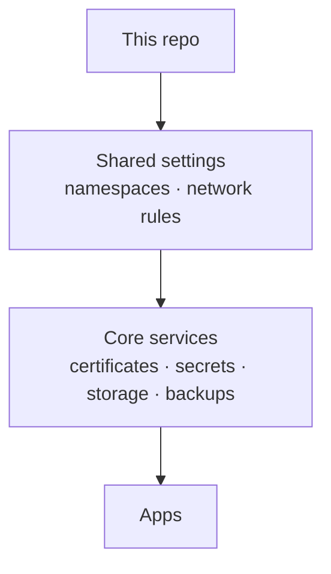

<div align="center">

# 🏠 Gabro's Homelab

_My home Kubernetes cluster — fully self-hosted and run straight from this repo._

[](https://k3s.io)
[](https://fluxcd.io)
[](https://www.mend.io/renovate)

[](https://github.com/gabroz42/k-homelab/actions/workflows/ci.yaml)
[](https://github.com/gabroz42/k-homelab/commits/main)

</div>

---

## Overview

This repo describes everything running on my home server. I change a file, push it, and the cluster updates itself to match. Nothing is set up by hand.

It started as a way to learn Kubernetes and grew into the thing that holds my photos, media and files. I try to run it the way I'd want things run at work: everything written down as config, no passwords in Git, automatic updates, backups that can't be tampered with, and alerts when something breaks.

Nothing is exposed directly to the internet. Public services go out through Cloudflare Tunnels, so there are no open ports on my router.

Most of the hardware is recycled from old upgrades or gifted by friends.

## Hardware

One machine does everything:

| Node      | CPU          | RAM   | Role                     |
| --------- | ------------ | ----- | ------------------------ |
| `homelab` | Ryzen 2600X  | 32 GB | Runs every app and disk  |

- **Two NVMe drives** (1 TB + 500 GB) for app data
- **A 2 TB hard drive** just for backups
- **Separate disks** for films, TV and music
- **A UPS** keeps it running through power cuts and sends me an alert if the battery gets low
- **Fan control** follows the motherboard's temperature sensors, with an emergency ramp-up if something overheats

## How it works

The cluster runs [k3s](https://k3s.io), a lightweight Kubernetes. The main building blocks:

- **Updates** — [Flux](https://fluxcd.io) keeps the cluster in sync with this repo. [Renovate](https://www.mend.io/renovate) suggests app updates, and k3s upgrades itself in a weeknight window.
- **Networking** — [Traefik](https://traefik.io) routes web traffic to the right app, [AdGuard Home](https://adguard.com/adguard-home/overview.html) handles DNS and blocks ads, and [Cloudflare Tunnels](https://github.com/cloudflare/cloudflared) publish the public services.
- **Security** — [Authentik](https://goauthentik.io) gives me a single login for every app, [cert-manager](https://cert-manager.io) handles HTTPS certificates, and every app is walled off so it can only talk to what it needs.
- **Storage** — [Longhorn](https://longhorn.io) manages the app disks and [MinIO](https://min.io) stores Nextcloud's files.
- **Monitoring** — [Prometheus](https://prometheus.io), [Loki](https://grafana.com/oss/loki/) and [Grafana](https://grafana.com) collect metrics and logs and turn them into dashboards and alerts.

### From Git to cluster

When I push to `main`, a webhook tells Flux right away, and Flux applies the change in three steps: shared settings first, then the core services, then the apps. Values that change per setup (domain, timezone, IP addresses, disk paths) live in one settings file instead of being repeated everywhere.



### Repo layout

```
clusters/homelab     # where Flux starts, plus the shared settings
infrastructure       # core services the apps depend on
apps                 # one folder per app
bootstrap            # script to rebuild the cluster on a new machine
docs                 # detailed handbook and runbooks
scripts              # helper scripts
schema               # architecture diagrams
```

<details>
<summary>Cluster diagram</summary>

<br>

<picture>
  <source media="(prefers-color-scheme: dark)" srcset="schema/cluster-schema-dark.png">
  <source media="(prefers-color-scheme: light)" srcset="schema/cluster-schema-light.png">
  
</picture>

</details>

## Services

### Public

Reachable from anywhere through Cloudflare. Most ask you to log in through Authentik first.

| Service                                                   | What it's for                                 |
| --------------------------------------------------------- | --------------------------------------------- |
| [Jellyfin](https://jellyfin.org)                          | Films & TV                                    |
| [Dispatcharr](https://github.com/Dispatcharr/Dispatcharr) | Live TV                                       |
| [Nextcloud](https://nextcloud.com)                        | Files & cloud storage                         |
| [Immich](https://immich.app)                              | Photo backup                                  |
| [Navidrome](https://navidrome.org)                        | Music                                         |
| [Matrix](https://matrix.org)                              | Chat                                          |
| [Authentik](https://goauthentik.io)                       | Single login for everything                   |
| [Grafana](https://grafana.com)                            | Monitoring dashboards                         |
| Centralino                                                | Home-automation panel                         |

### Home network only

Reachable at `*.local.gabro.ovh` from inside my network.

| Service                                                        | What it's for                                       |
| -------------------------------------------------------------- | --------------------------------------------------- |
| \*arr stack                                                    | Finding and organising films, TV and music          |
| [AdGuard Home](https://adguard.com/adguard-home/overview.html) | DNS and ad blocking                                 |
| [Headlamp](https://headlamp.dev)                               | Kubernetes dashboard                                |
| Pankha                                                         | Fan & temperature control                           |
| Homepage                                                       | Start page linking every service                    |

The server itself is only reachable over VPN.

## Network

All traffic ends up at Traefik. Visitors from the internet come in through a Cloudflare Tunnel and have to log in before reaching an app. Devices at home skip all that: AdGuard points `*.local.gabro.ovh` straight at the server.


## Backups

Every week, app data and databases are copied with [restic](https://restic.net) to the backup drive. The backup server only accepts new backups and never lets anyone delete or overwrite old ones, so a hacked app can't wipe them. I keep 7 daily, 4 weekly and 12 monthly copies, and I get an alert if a backup fails or goes stale.

## Secrets

No passwords or tokens are stored in this repo. They live in [Bitwarden Secrets Manager](https://bitwarden.com/products/secrets-manager/) and are pulled into the cluster when needed. When one changes, the apps using it restart automatically. Rotating a password is a single command:

```sh
task autorotate-postgres app=nextcloud   # new database password, everywhere
task rotate-tunnel svc=jellyfin          # new Cloudflare tunnel token
```

## Rebuilding from scratch

If the server dies, a single script sets the whole cluster up again on a fresh Ubuntu machine:

```sh
cp bootstrap/site.env.example bootstrap/site.env   # fill in your domain, IPs and tokens
task render-settings                               # turn it into the settings file, then push
task bootstrap                                     # run on the new machine
```

It brings back the apps and config. The data comes back separately, from the backups. The full walkthrough is in [`docs/INSTRUCTIONS.md`](docs/INSTRUCTIONS.md).

## Day to day

```sh
task status      # what's running
task bad         # anything broken
task reconcile   # sync with Git right now
```

Every change is checked automatically before it's merged, using [kubeconform](https://github.com/yannh/kubeconform) and [flate](https://github.com/home-operations/flate).
