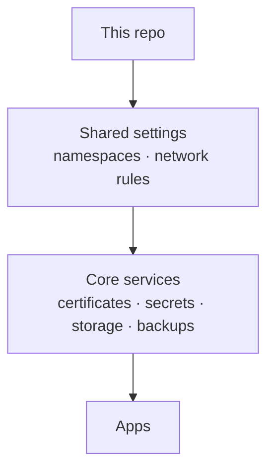
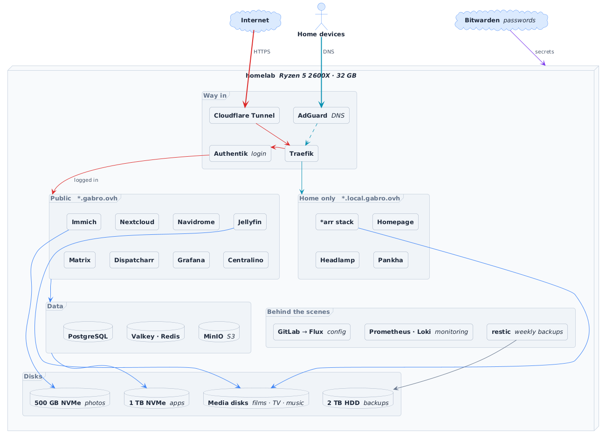
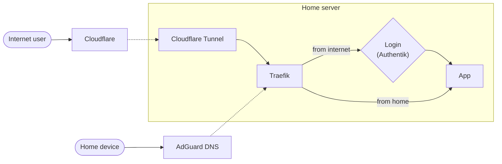

<div align="center">

# 🏠 K-Homelab

_My home server. Built from old PC parts and GitOps-managed from this repo through Flux._

[](https://k3s.io)
[](https://fluxcd.io)
[](https://www.mend.io/renovate)

[](https://github.com/gabroz42/k-homelab/actions/workflows/ci.yaml)
[](https://github.com/gabroz42/k-homelab/commits/main)

</div>

---

A single k3s node that hosts what I use every day: photos, cloud storage, media, private chat, and the GitLab where this repo lives.

No changes are made on the server directly. Configurations are pushed here, then Flux applies the changes. Passwords are kept in Bitwarden, backups run every week, and there's a script to rebuild everything on a new machine.

## The hardware

Almost all hardware used was recycled from previous PC upgrades or gifted by friends. The only things I had to buy were the micro-ATX parts (mobo, case and PSU, the cheapest I could find).

| Part              | What                       |
| ----------------- | -------------------------- |
| **CPU**           | AMD Ryzen 2600X            |
| **RAM**           | 32GB DDR4                  |
| **Main drive**    | 1TB Sabrent NVMe           |
| **Storage NVMe**  | 500GB Samsung NVMe (photos)|
| **Films drive**   | 4TB HDD                    |
| **Backup drive**  | 2TB HDD                    |
| **UPS**           | 600W                       |

The system and the cloud storage services that need to be fast run on the NVMe drives. The UPS is monitored too, so I get an alert on a power cut or when the battery is getting tired, and the fans are controlled by Pankha based on the motherboard sensors.

## The software

Here is how this cluster is configured:

| Software                                                       | Used for                                               |
| -------------------------------------------------------------- | ------------------------------------------------------ |
| [k3s](https://k3s.io)                                          | Light Kubernetes distribution                    |
| [Flux](https://fluxcd.io)                                      | GitOps operation               |
| [Renovate](https://www.mend.io/renovate)                       | Opens merge requests on version updates |
| [Traefik](https://traefik.io)                                  | Ingress controller                                     |
| [MetalLB](https://metallb.io)                                  | Load balancer                                          |
| [Cloudflare Tunnels](https://github.com/cloudflare/cloudflared) | Remote access to the public services                  |
| [AdGuard Home](https://adguard.com/adguard-home/overview.html) | DNS and ad blocking                                    |
| [Authentik](https://goauthentik.io)                            | Single login for every app                             |
| [cert-manager](https://cert-manager.io)                        | HTTPS certificates                                     |
| [Longhorn](https://longhorn.io)                                | App storage                                            |
| [Prometheus](https://prometheus.io), [Loki](https://grafana.com/oss/loki/), [Grafana](https://grafana.com) | Metrics, logs and alerts |

When I push to `main`, a webhook tells Flux right away and the change gets applied in three steps: shared settings, then core services, then apps. Values that change between setups (domain, timezone, IPs, disk paths) are written once in a single settings file.



### Repo layout

```
clusters/homelab     # where Flux starts, plus the shared settings
infrastructure       # core services the apps depend on
apps                 # one folder per app
bootstrap            # script to rebuild the cluster on a new machine
docs                 # detailed handbook and runbooks
scripts              # helper scripts
schema               # architecture diagrams
```

<details>
<summary>Cluster diagram</summary>

<br>

<picture>
  <source media="(prefers-color-scheme: dark)" srcset="schema/cluster-schema-dark.png">
  <source media="(prefers-color-scheme: light)" srcset="schema/cluster-schema-light.png">
  
</picture>

</details>

## Networking

First, a pool of IP addresses is reserved for MetalLB and Traefik is given an IP.
Then, a DNS rewrite is configured in AdGuard Home so browsers in my network can reach every local service at `*.local.gbroccoli.dev` by asking Traefik for it via hostname. For publicly exposed services Traefik is set as the target of the Cloudflare tunnels.

All services exposed to the outside world do so via a Cloudflare tunnel pod, so no ports are open on my router. Each tunnel runs two pods, so if one goes down the service stays up. Public services also go through Authentik, so you have to log in before reaching any app.



### Public services

Here are the services that are exposed to the internet:

| Service                                                   | Used for                                        |
| --------------------------------------------------------- | ----------------------------------------------- |
| [Jellyfin](https://jellyfin.org)                          | Streaming films and TV                          |
| [Dispatcharr](https://github.com/Dispatcharr/Dispatcharr) | Live TV                                         |
| [Nextcloud](https://nextcloud.com)                        | General purpose cloud storage for files         |
| [Immich](https://immich.app)                              | Mobile photo/video management and sync               |
| [Navidrome](https://navidrome.org)                        | Music streaming                                 |
| [Matrix](https://matrix.org)                              | Friends Chat                                            |
| [Grafana](https://grafana.com)                            | Monitoring                                      |
| [GitLab](https://about.gitlab.com)                        | Hosting repos and running pipelines            |
| [Authentik](https://goauthentik.io)                       | Centralized authentication provider             |
| Centralino                                                | Home automation panel      |

### Private services

| Service                                                        | Used for                                                 |
| -------------------------------------------------------------- | -------------------------------------------------------- |
| Arr stack                                                      | Feeding Jellyfin and Navidrome                           |
| [AdGuard Home](https://adguard.com/adguard-home/overview.html) | Network filter and DNS rewrites in the local network     |
| [Headlamp](https://headlamp.dev)                               | Kubernetes dashboard                                     |
| Pankha                                                         | Fan and temperature control                              |
| [Homepage](https://gethomepage.dev)                            | Homepage with all apps                            |

The server itself is only reachable over VPN.

## Storage and backups

- **Longhorn** manages the NVMe drives for the apps
- **MinIO** is used as S3 storage behind Nextcloud
- **Backup jobs** copy app data and databases with restic to the backup drive every week

The backup server only accepts new backups and never lets any new backups delete or overwrite the old ones, so apps can't wipe them. I keep 7 daily, 4 weekly and 12 monthly copies and get an alert if a backup fails. Every week the backups are also mirrored offsite to Backblaze B2, so they survive losing the whole server.

## Alerting

Alerts arrive by email through Mailjet. Prometheus keeps an eye on the backups, the disks, Longhorn and the pods, and Flux reports any update that fails to deploy. Emails are grouped and spaced out, so a bad day doesn't flood my inbox.

The UPS has its own emails, which also go to a second person at home: one when the power goes out, one when it comes back. If the battery runs low, NUT shuts the server down cleanly before it dies.

If the whole server goes quiet, an outside check on [healthchecks.io](https://healthchecks.io) notices the missing heartbeat and emails me.

## Secrets

No passwords or tokens are in this repo. They are stored in Bitwarden Secrets Manager and pulled into the cluster when needed. When a secret changes, the apps using it restart automatically.

## Rebuilding from scratch

If the server dies, a single script sets the whole cluster up again on a fresh Ubuntu machine:

```sh
cp bootstrap/site.env.example bootstrap/site.env   # fill in your domain, IPs and tokens
task render-settings                               # turn it into the settings file, then push
task bootstrap                                     # run on the new machine
```

This brings back the apps and the config. A more detailed description in [`docs/INSTRUCTIONS.md`](docs/INSTRUCTIONS.md).

## Handy Tools

```sh
task status      # what's running
task bad         # anything broken
task reconcile   # sync with Git right now
```

Every change is checked automatically before it's merged, using [kubeconform](https://github.com/yannh/kubeconform) and [flate](https://github.com/home-operations/flate).
